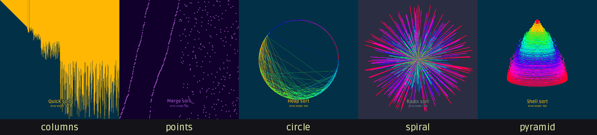
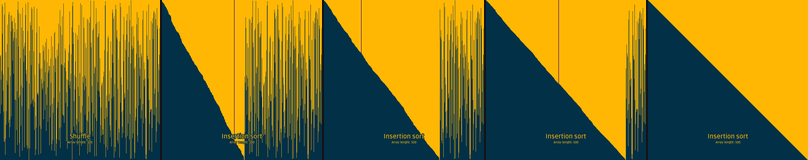
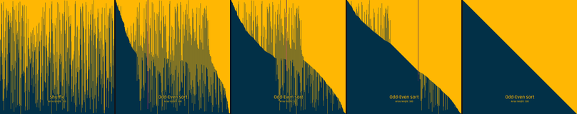
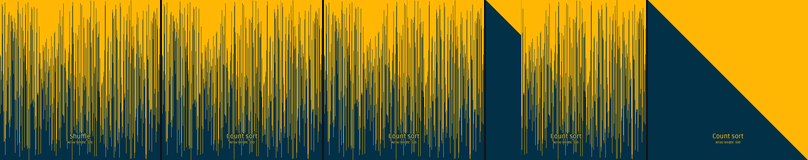
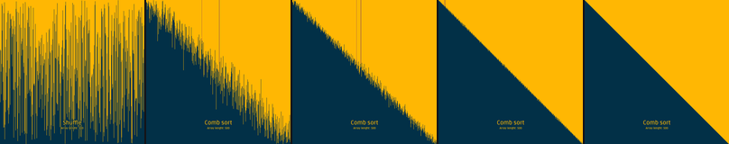
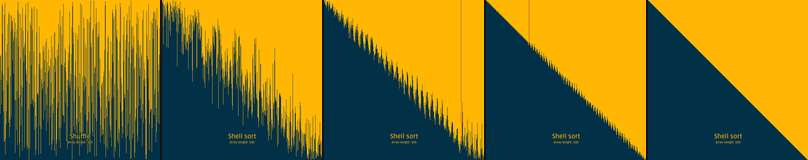
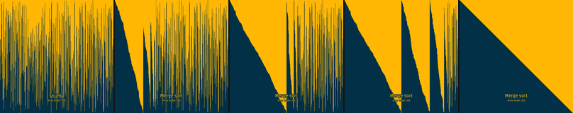
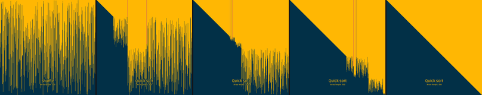
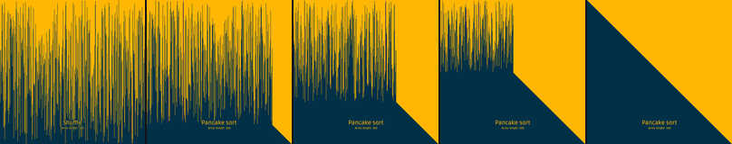
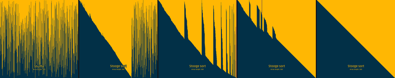

# sort_visualization

A sorting algorithm visualizer in C++ with SFML: 16 algorithms, 5 ways to draw the array.


All images on this page are frames saved by the program itself (see [Record](#record)).

## What it does

- 16 sorting algorithms on an array of 500 values.
- 3 ways to fill the array before sorting: ascending, descending, random. The program also shuffles the array between runs.
- 5 layouts: columns, points, circle (the menu calls it "Circumference"), spiral, pyramid.
- 5 colour themes.
- An option to set the order in which the sorting algorithms run.
- The two values that the algorithm touches in a step get a highlight colour.



## How it works

1. **Menu.** You pick a layout, and in the settings a theme, the fill order and the order of the algorithms.
2. **Fill.** The menu fills the array (ascending by default).
3. **Shuffle.** Before each algorithm, a shuffle mixes the array. The shuffle is drawn too.
4. **Sort.** The algorithms run one after another. Each algorithm calls `drawing()` once per step (a compare, a swap or a write) with the two indexes it works on.
5. **Draw.** `drawing()` asks `ArrayDrawer` to draw the array. The drawer maps each value onto the chosen layout: a column height, a point height, a position on a circle, a spiral radius, or an ellipse size in the pyramid. In the circle, spiral and pyramid layouts the colour also comes from the value.

At normal speed every step is drawn. When you speed up, only every n-th step is drawn.

Code: `Code/Main.cpp` (main loop, `drawing()`, record mode), `Code/Menu.cpp`, `Code/SortAlgorithms.cpp`, `Code/ShuffleAlgorithms.cpp`, `Code/ArrayDrawer.cpp` (layouts).

## Controls

| Key | Action |
| --- | --- |
| Up / Down, W / S | Move in the menu |
| Left / Right, A / D | Change a setting or table cell |
| Enter | Select |
| Right / D during a sort | Speed up |
| Left / A during a sort | Slow down (back to normal speed) |
| Esc | Back to the menu |

Known detail: Esc during a sort restarts the menu with a recursive call to `main()`. This is kept as is.

## Run

You need a C++17 compiler, CMake 3.10 or newer, and SFML 2.x (graphics, window, system).

Linux (Debian or Ubuntu):

```sh
sudo apt install build-essential cmake libsfml-dev
cmake -S . -B build
cmake --build build
cd build && ./sort_visualization
```

If SFML is not installed in a system path, tell CMake where it is: `cmake -S . -B build -DCMAKE_PREFIX_PATH=<sfml prefix>`. The build was tested on Linux with SFML 2.6.2 this way.

The program loads `font/Ruda-Medium.ttf` from the working directory. CMake copies the font next to the executable, so run the program from `build/`.

Windows: install SFML 2.x, point CMake to it with `-DSFML_DIR=<path>/lib/cmake/SFML`, and build with Visual Studio or MinGW. Put the SFML DLLs next to the executable. This repository does not contain pre-built binaries or DLLs.

## Record

Record mode saves one run as PNG frames. It skips the menu and does not open a window: it draws into an offscreen texture. It runs one clip (sorted array, shuffle, sort, sorted array) and exits. Without `SORTVIS_RECORD` the program works as before.

| Variable | Meaning | Default |
| --- | --- | --- |
| `SORTVIS_RECORD` | Folder for the frames (`f000000.png`, ...). Turns record mode on. The folder must exist. | off |
| `SORTVIS_LAYOUT` | `columns`, `points`, `circle`, `spiral` or `pyramid` | `columns` |
| `SORTVIS_SORT` | Algorithm name as in the menu table, for example `Quick`, `Odd-Even` | `Quick` |
| `SORTVIS_FRAMES` | About how many frames the sort gets. The shuffle gets 1/6 of this. | `300` |
| `SORTVIS_THEME` | Colour theme, 0 to 4 | `0` |
| `SORTVIS_SEED` | Random seed for the shuffle | `1` |

The program first runs the algorithm once without drawing to count its steps. Then it saves one frame every (steps / frames) steps. So a slow algorithm and a fast one both give about the same number of frames.

```sh
cd build
mkdir -p frames
SORTVIS_RECORD=frames SORTVIS_LAYOUT=spiral SORTVIS_SORT=Radix SORTVIS_FRAMES=60 ./sort_visualization
```

SFML still needs a graphics context, so on Linux it needs a running X or Wayland session, but no window appears.

To make a GIF from the frames (this is how `docs/hero.gif` was made, one clip per layout, joined):

```sh
ffmpeg -framerate 15 -i frames/f%06d.png \
  -vf "scale=480:-1:flags=lanczos,split[a][b];[a]palettegen=max_colors=64:stats_mode=diff[p];[b][p]paletteuse=dither=none:diff_mode=rectangle" \
  clip.gif
```

## Algorithms

Each strip shows, from left to right: the shuffled array, the sort at about 25 %, 50 % and 75 % of its steps, and the sorted array. Columns layout, theme 0, seed 1.

### Bubble

Swaps neighbours that are in the wrong order. The large values move to the end first.


### Insertion

Takes the next value and moves it left into the sorted part.



### Gnome

Like insertion sort, but it moves one swap at a time, forward and back.


### Selection

Finds the smallest value in the unsorted part and puts it at the front.


### Odd-Even

Compares pairs at odd positions, then pairs at even positions, until no swap happens.



### Count

Counts how often each value occurs, then writes the values back in order.



### Pigeonhole

Puts each value into its own hole, then reads the holes in order.


### Radix

Sorts by the last digit, then the next digit, and so on (base 10).


### Comb

Bubble sort with a gap that gets smaller each pass.



### Shell

Insertion sort on values a gap apart, with smaller gaps each pass.



### Merge

Sorts both halves, then merges them.



### Quick

Splits the array round a pivot, then sorts each part.



### Pancake

Flips the front of the array to bring the largest value to its place.



### Cocktail

Bubble sort in both directions.


### Heap

Builds a max-heap, then moves the top to the end, again and again.


### Stooge

Sorts the first 2/3, the last 2/3, then the first 2/3 again. It is very slow.



## Stack

- C++17
- SFML 2.5 or newer (tested with 2.6.2)
- CMake

## Status

A school project, finished in 2022. No new features are planned. In 2026 a record mode and this README with images were added.

## License

MIT, see `LICENSE`. The font `Code/font/Ruda-Medium.ttf` is Ruda under the SIL Open Font License 1.1, see `Code/font/OFL.txt`.

Part of my portfolio: https://ilyaeis.github.io/?go=sorting
